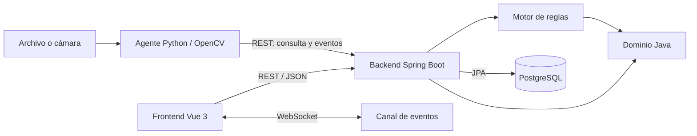

# Arquitectura y organización de paquetes

> Corte: `43ae3cba25f5dcdead273982cb1f810df0222ba8`, rama `feature/vision-tracking-agent`.

## 1. Vista general

PoolHawk utiliza una arquitectura modular en la que el dominio y las reglas de billar están separados de la infraestructura web. La solución completa incluye frontend, backend, PostgreSQL y un agente externo de visión computarizada.

## 2. Módulos Maven del backend

### 2.1 `billiard-domain` — dominio puro

Paquetes identificados:
- `table`: `Bola`, `Coordenada`, `Mesa`, `TipoBola`, `Tronera`, `TroneraNombre`.
- `player`: `Jugador`, `Equipo`.
- `match`: `Partida`, `MatchState`, `Turnos`, `FormatoJuego`, `TipoModalidad`, `FasePartida`, `ConfiguracionJuego`, `Grupo`.
- `event`: `TiroEvent`, `ResultadoTiro`, `FaltaMotivo`.

Este módulo representa el negocio y no debe depender de Spring ni de JPA.

### 2.2 `billiard-rules` — reglas de juego

Clases identificadas:
- `ReglasBillar`: contrato de evaluación.
- `AbstractReglasBillar`: comportamiento común y plantilla.
- `ReglasBola8` y `ReglasPorPuntos`: estrategias concretas.
- `ReglasFactory`: selección/creación de la estrategia.
- `ReglasConfig`: configuración de reglas.

Depende del dominio, no de la API.

### 2.3 `billiard-api` — aplicación e infraestructura

Paquetes y responsabilidades identificados:
- `controller`: `MatchController`, `EventController`, `AuthController`, `UserController`, `VideoAnalysisController`.
- `service`: `MatchService`, `MatchFactory`, `MatchStorage` y servicios auxiliares.
- `mapper`: conversión entre dominio, DTO y persistencia; incluye `MatchPersistenceMapper` y `PartidaMapper`.
- `entity`: entidades JPA como `PartidaEntity`, `JugadorEntity`, `UsuarioEntity`.
- `event`: eventos de aplicación y listener de actualización de partida.
- `security`: JWT, filtro de autenticación y configuración de seguridad.
- `websocket`: interceptor de handshake y manejador de sesiones en vivo.
- `dto`, `exception`, `repository` y configuración: contratos, errores y acceso a infraestructura.

## 3. Frontend

Frontend Vue 3/Vite con componentes identificados:
- Autenticación: `LoginView.vue` y composable `useAuth`.
- Partidas: `CreateMatchForm.vue`, `MatchHistory.vue`.
- Marcadores: `ScoreBoard.vue`, `ScoreBoardEquipos.vue`, `ScoreBoardTodosVsTodos.vue`.
- Operación/corrección: `ShotSimulator.vue`, `CorrectionModal.vue`, `ToastContainer.vue`.
- Análisis: `VideoAnalysisConfig.vue`, `CameraSelectionModal.vue`.
- API cliente: módulos `auth.js`, `matches.js`, `videoAnalysis.js`, `http.js`, `endpoints.js`.

## 4. Agente Python/OpenCV

Módulos identificados:
- `vision_agent.py`: orquestación del pipeline y CLI.
- `camera_source.py`: abstracción de fuente de cámara/video.
- `ball_detector.py`: detección de bolas.
- `ball_classifier.py`: clasificación visual.
- `ball_tracker.py`: asociación temporal e identidad de pistas.
- `shot_analyzer.py`: inferencia de tiros.
- `config_agente.py` y `calibracion.py`: configuración y calibración.
- `api_client.py`: integración REST.
- `cola_eventos.py`: persistencia local de eventos pendientes.
- `traza.py`: trazabilidad de estados de envío.
- `simulador.py`: apoyo a simulación.

## 5. Persistencia y transacciones

`MatchService` coordina casos de uso de partidas. La creación se delega en `MatchFactory`; la conversión dominio/persistencia se delega en `MatchPersistenceMapper`; el almacenamiento se abstrae mediante `MatchStorage`. `PartidaEntity` incorpora control de versión JPA con `@Version`.

Al registrar un tiro, el servicio carga el estado desde almacenamiento, comprueba idempotencia y versión, valida el turno, construye el evento, aplica las reglas y guarda la nueva representación. Los eventos de actualización se publican para difusión después de confirmar la transacción.

## 6. Despliegue local

Docker Compose define servicios PostgreSQL, backend y frontend. PostgreSQL usa el volumen `poolhawk_data`. En el corte auditado no se observó un volumen equivalente para `uploads/videos`; la persistencia de archivos de video debe resolverse antes de depender de ellos entre recreaciones del contenedor.

## 7. Principios arquitectónicos

- Dominio independiente de infraestructura.
- Reglas intercambiables mediante Strategy.
- Separación de creación, orquestación, mapeo y almacenamiento.
- Persistencia como fuente de verdad.
- Validación de eventos antes de modificar el estado.
- Comunicación asíncrona después del commit.
- Agente de visión desacoplado del backend mediante contrato HTTP.
