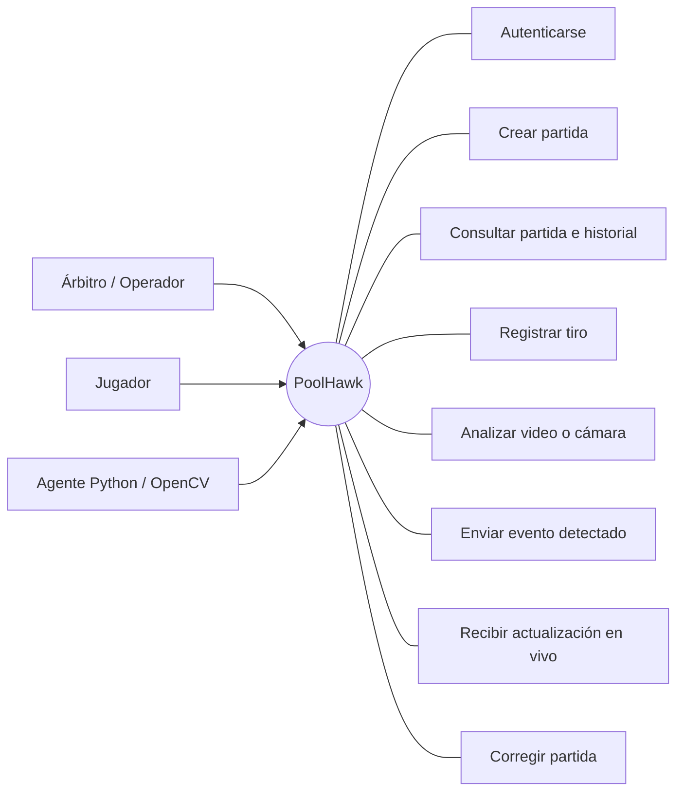

# Casos de uso del sistema PoolHawk

## 1. Actores

- **Árbitro / operador:** crea partidas, supervisa el marcador y puede gestionar correcciones según permisos.
- **Jugador:** participa en la partida y consulta el estado.
- **Agente de visión:** procesa una fuente visual y propone eventos de tiro a la API.
- **Administrador:** gestiona el acceso al sistema cuando la configuración de seguridad lo habilita.

## 2. Casos de uso principales

### CU-01 — Autenticarse
- **Actor:** usuario.
- **Precondición:** cuenta habilitada.
- **Flujo:** envía credenciales; backend valida y emite JWT; frontend conserva el estado de autenticación para las solicitudes autorizadas.
- **Alternativa:** credenciales inválidas o usuario no autorizado; se rechaza el acceso.

### CU-02 — Crear partida
- **Actor:** árbitro/operador.
- **Precondición:** usuario autenticado.
- **Flujo:** selecciona modalidad y formato, ingresa jugadores y configuración; frontend envía solicitud; backend valida la cantidad de participantes, construye el dominio y persiste la partida.
- **Alternativa:** datos incompletos o combinación de modalidad/formato inválida; se devuelve error de validación.

### CU-03 — Consultar partida e historial
- **Actor:** árbitro, jugador autorizado.
- **Flujo:** solicita el identificador o listado; backend consulta almacenamiento y responde con DTO de partida.

### CU-04 — Registrar tiro desde la interfaz
- **Actor:** árbitro/operador.
- **Precondición:** partida en curso.
- **Flujo:** envía jugador, primera bola tocada, bolas embolsadas, troneras, duración, eventId y versión esperada; backend carga estado fresco, verifica idempotencia, versión, turno y datos, evalúa reglas y persiste el resultado.
- **Alternativas:** partida inexistente, datos inválidos, turno incorrecto o conflicto de versión; se rechaza sin aplicar un estado inconsistente.

### CU-05 — Analizar video o cámara
- **Actor:** operador y agente de visión.
- **Precondición:** fuente de video accesible; configuración de agente y calibración adecuadas.
- **Flujo:** operador carga un video o configura la fuente; crea o selecciona una partida; ejecuta `vision_agent.py`; el agente detecta, clasifica y sigue bolas, analiza tiros y prepara eventos confiables.
- **Alternativas:** cámara no disponible, configuración inválida, falta de calibración o evidencia ambigua; se informa el problema y/o se requiere revisión manual.
- **Nota de implementación:** la conexión de cámara representada en `VideoAnalysisConfig.vue` es simulada en el commit de referencia.

### CU-06 — Enviar evento detectado
- **Actor:** agente de visión.
- **Precondición:** partida consultable y tiro no marcado para revisión.
- **Flujo:** consulta el estado para obtener jugador actual y versión; construye payload con `eventId`; envía POST a la API; conserva el evento en cola si ocurre un fallo de red; registra transiciones en la traza.
- **Alternativas:** conflicto de versión, cola bloqueada, estado no disponible o rechazo de negocio; se detiene el reenvío automático y se requiere reconciliación cuando corresponda.

### CU-07 — Recibir actualización en tiempo real
- **Actor:** cliente autorizado.
- **Precondición:** sesión WebSocket autenticada y suscrita a una partida autorizada.
- **Flujo:** backend publica el evento después del commit y distribuye la actualización a las sesiones asociadas a esa partida.
- **Nota:** en el commit de referencia se detectó una inconsistencia entre la extracción de matchId del JWT y la agrupación de sesiones; debe corregirse y probarse el aislamiento entre partidas.

### CU-08 — Corregir una partida
- **Actor:** árbitro/operador autorizado.
- **Flujo:** utiliza la funcionalidad de corrección expuesta por la interfaz y API, según los permisos y reglas implementados. Documentar aquí el contrato exacto una vez verificado contra el controlador y servicio vigentes.

## 3. Diagrama de casos de uso

## 4. Límites del sistema

El agente visual no reemplaza el motor de reglas. La percepción genera observaciones; el backend valida y aplica eventos. Cuando la evidencia visual es insuficiente, el flujo correcto es revisión manual, no inventar un resultado.
