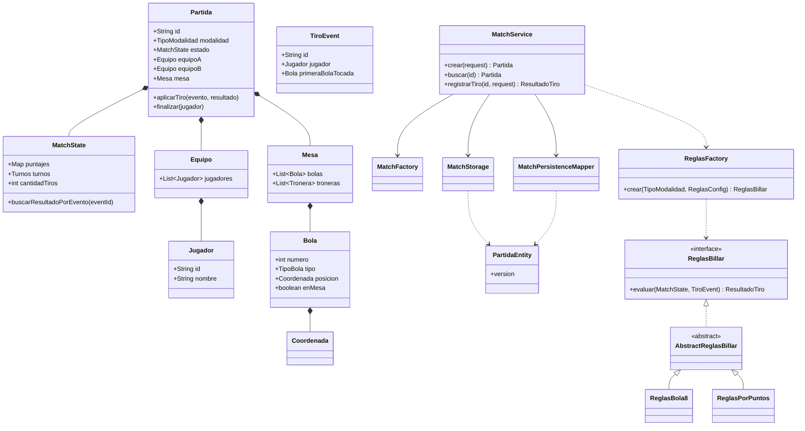

# Diagrama de clases del dominio y servicios

> Vista conceptual basada en las clases identificadas en el commit de referencia. No sustituye un UML completo generado desde todos los atributos y métodos del código.

## Observaciones
- El dominio incluye también `FormatoJuego`, `TipoModalidad`, `FasePartida`, `ConfiguracionJuego`, `Grupo`, `Turnos`, `TroneraNombre`, `ResultadoTiro` y `FaltaMotivo`.
- En infraestructura existen entidades JPA como `PartidaEntity`, `JugadorEntity` y `UsuarioEntity`.
- El diagrama resume responsabilidades y relaciones de alto nivel; verificar cardinalidades, atributos y firmas antes de usarlo como diagrama final de clases.
