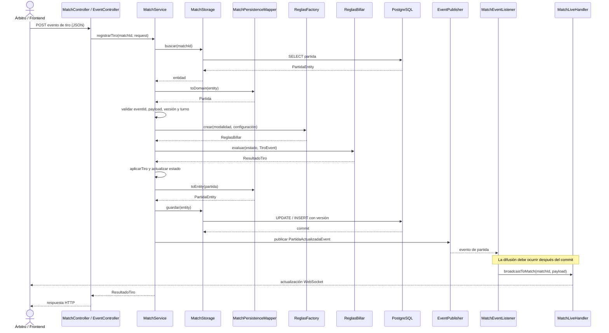

# Diagrama de secuencia — Registro de tiro

El diagrama representa el flujo lógico del backend en el corte documentado. Se omiten detalles internos de DTO y manejo de excepciones para facilitar su lectura.

## Consideraciones
- La base de datos es la fuente de verdad.
- El servicio realiza comprobación idempotente por `eventId` y valida `versionEsperada`.
- JPA `@Version` protege frente a escrituras concurrentes.
- El evento se publica para difusión después de confirmar la transacción.
- El enrutamiento de sesiones por partida requiere una suscripción autorizada y pruebas de aislamiento; el diagrama representa el objetivo de integración, no certifica que el enrutamiento esté resuelto en este commit.
