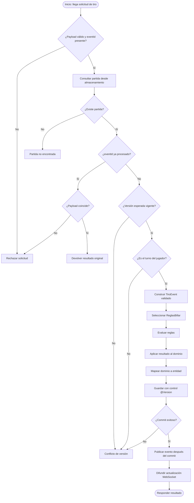

# Diagrama de actividades — Procesamiento de un tiro

## Notas
- Los errores de validación, partida inexistente y conflicto no deben mutar el estado persistido.
- Si el evento ya fue procesado con el mismo contenido, se devuelve el resultado original.
- La difusión WebSocket depende de una asociación correcta entre sesión y partida autorizada.
