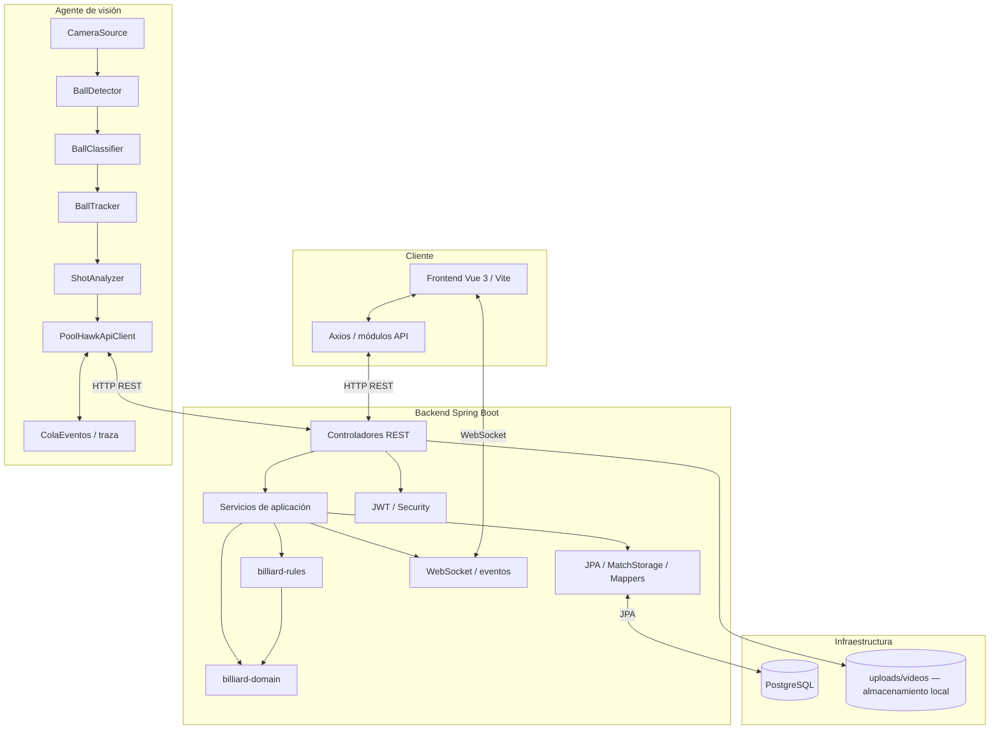

# Diagrama de componentes de PoolHawk

## Alcance del diagrama
- La arquitectura refleja componentes presentes en el repositorio.
- El agente es un proceso Python independiente; no forma parte del proceso Spring.
- La carpeta de videos se muestra como almacenamiento local porque el controlador usa `uploads/videos`. En el Docker Compose del corte no se configuró un volumen persistente para esa carpeta.
- El diagrama no implica que la conexión de cámara del frontend esté implementada: el indicador de conexión en `VideoAnalysisConfig.vue` es simulado en este corte.
