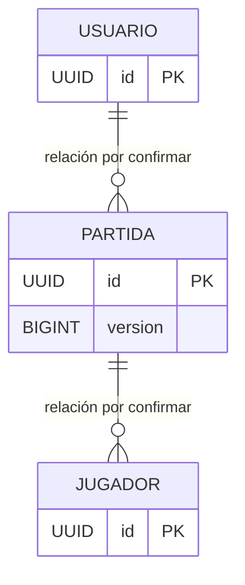

# Modelo de datos y persistencia

> **Importante:** este archivo no debe interpretarse como un MER físico certificado. El diagrama anterior del proyecto incluía tablas `EQUIPO` y `EVENTO_TIRO` sin evidencia suficiente en el esquema JPA revisado. Se reemplaza por una vista conceptual y se deja pendiente la verificación contra migraciones y entidades completas.

## Entidades JPA identificadas

En el árbol de código del commit de referencia aparecen:
- `PartidaEntity`
- `JugadorEntity`
- `UsuarioEntity`

`PartidaEntity` incluye control optimista de concurrencia mediante `@Version`. El dominio mantiene historial/estado de tiros y el servicio transforma ese modelo a la representación persistente.

## Vista conceptual (no sustituye el esquema físico)

## Pendiente para cerrar el MER
1. Revisar todas las entidades JPA, anotaciones `@OneToMany`, `@ManyToOne`, `@ManyToMany` y `@Embedded`.
2. Revisar migraciones SQL y restricciones reales.
3. Confirmar claves primarias, foráneas, índices, nulabilidad y tipos.
4. Generar el MER físico desde el esquema vigente.
5. Elaborar el diccionario de datos con nombre, tipo, nulabilidad, clave y descripción por columna.

No agregar tablas o relaciones por suposición. Si el historial de tiros se serializa dentro de la entidad de partida, debe documentarse de esa forma y no inventar una tabla separada.
